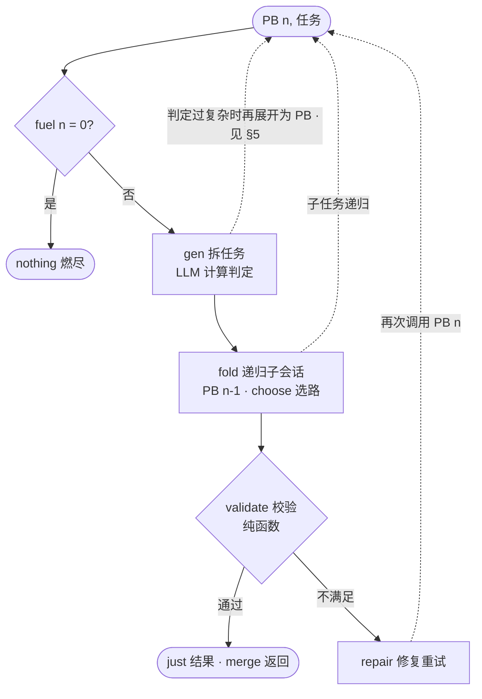

# LLM 推进任务的递归表示（纯 λ 核心）

本文件把「推进任务的 LLM 会话」归纳成一个**无副作用**的 λ-演算核心，用于统一描述
任务拆解、子会话递归、选路、校验与重试。它只描述**计算**，不描述 IO。

---

## 0. 结论先行

- 会话 = 纯函数 `PB : Nat → Cin → Maybe Cout`。
- 递归不求不动点，用 **level 当 fuel 的结构递归**，终止性由类型保证。
- 副作用一律外移到**驱动层**，项语言里不存在 IO。
- 非确定性只有两个入口常数：`choose`（选项判定）与 `gen`（计算判定）。

---

## 1. 类型

```text
κ ::= Det | NDet              -- 确定性等级；子类型规则：Det τ ≤ NDet τ
τ ::= κ σ
σ ::= σ → σ | σ × σ | List σ | Maybe σ | Nat | Task | Result
```

- `Det` 表示纯函数，`NDet` 表示依赖 LLM 的判定。
- 组合子全部**保 Det**；只有 `choose` / `gen` 产出 `NDet`。
- `Det τ ≤ NDet τ`：确定性结果可直接喂给非确定性上下文，反之不行。

## 2. 项语言（最小语法）

```text
e ::= x | λx. e | e₁ e₂                 -- 抽象 / 应用
    | ⟨e₁, e₂⟩ | fst | snd              -- 积：合并多个子结果
    | if e₁ then e₂ else e₃             -- 分支
    | fold e₁ e₂ e₃                     -- 列表折叠，替代 for 循环
    | just e | nothing | orElse e₁ e₂   -- 失败用 Maybe 表达，没有 throw
    | choose | gen                      -- 仅有的两个非确定源

choose : List (NDet τ) → NDet τ         -- LLM 选项判定：从候选中选一个
gen    : NDet τ₁ → NDet τ₂              -- LLM 计算判定：产出满足约束的值
```

**除 `choose` / `gen` 外，所有组合子都保 `Det`。** 非确定性只能从这两个口子进入系统，
并且一定被类型标注出来。

## 3. 递归 = fuel 结构递归

```text
PB : Nat → Cin → Maybe Cout
PB zero     = λ_. nothing               -- 燃尽即失败，天然终止
PB (succ n) = λx. body                  -- body 内只允许调用 PB n
```

- 「级别」= `Nat` 燃料，递归深度受控。
- 「输入约束类型 / 输出约束类型」= `Cin` / `Maybe Cout`。
- `try/catch` 消解为 `Maybe` + `orElse`；`for` 消解为 `fold`；`PB₁; PB₂` 消解为函数复合。

## 4. 通用会话形态

```text
session : Nat → Task → Maybe Result
session zero     _    = nothing
session (succ n) task =
    let subs : List Task = gen (decompose task)            -- 计算判定：拆任务
    in fold (λacc t. case session n t of                   -- 递归子会话 = fold
                 nothing → acc                             -- 子失败不炸，记为缺席
                 just r  → r :: acc)
            [] subs
    |> λrs -> if validate rs                               -- 纯函数校验输出约束
              then just (merge rs)                         -- return：合并后返回
              else orElse (session n (repair task)) nothing -- 修复重试，或放弃
```

其中 `decompose / validate / merge / repair` 均为 `Det` 纯函数；选路用 `choose`，生成用 `gen`（二者本身可再展开，见 §5）。

---

## 5. 判定的递归展开：确定性剥离

`gen` / `choose` 不是原子叶子。**任何一次 LLM 判定，只要复杂度超过阈值，就应当再展开成一次 PB 递归**——因为不确定的大流程里，往往混着大量可以改写成纯函数的确定子流程。

```text
-- 展开规则（驱动层按复杂度判定）
gen(task)   ⟹  PB(n−1, task)          当 complexity(task) > θ
choose(os)  ⟹  choose' (filter os)    当存在 Det 谓词可先筛候选

-- 展开后的 body 形态：Det 函数链 ∘ 更小的判定核
PB(n−1, task) = detPipe ∘ gen'(core)   其中 core ⊂ task, size(core) < size(task)
```

不变量：**NDet 核随递归深度单调收缩**。每展开一层，可确定化的部分被剥离成 `Det` 纯函数（可缓存、可单测、可复用），只有真正需要 LLM 的核留给下一层的 `gen'` / `choose'`。极限情况：核被剥空，整个子流程变成纯 `Det` 函数组合，LLM 只出现在叶子。

- `choose` 的特化形态是 **filter-then-choose**：先用 `Det` 谓词过滤候选集，`choose` 只在剩余候选上判定——候选集越小，判定越便宜、越可靠。
- `complexity` 的度量与阈值 `θ` 属于驱动层配置，不在项语言内。
- 终止性仍由 fuel 保证：展开消耗 `n−1`，与普通子会话同级。

---

## 6. 原 PB 草图 → λ 表示对照

| 草图元素 | λ 表示 |
|---|---|
| `PB（级别，输入约束类型）→ 输出约束类型` | `PB : Nat → Cin → Maybe Cout` |
| 「级别」 | `Nat` 燃料，结构递归的递减参数 |
| 「输入约束类型（确定型 / 非确定型）」 | `Det` / `NDet` 等级标注 |
| 「LLM 选项判定」 | `choose : List (NDet τ) → NDet τ` |
| 「LLM 计算判定」 | `gen : NDet τ₁ → NDet τ₂` |
| `PB1; PB2`（顺序） | 函数复合 `λx. PB₂ n (PB₁ n x)` |
| `for { 计(PBn) }`（循环） | `fold` |
| `if (PBn)`（分支） | `if e₁ then e₂ else e₃` |
| `return ~` | `just` |
| `catch (e) { ~ }` | `orElse` / `Maybe`（失败非异常，是值） |
| 「确定型可喂给非确定型」 | 子类型 `Det τ ≤ NDet τ` |

## 7. 流程图（只含纯核心，不含 IO）



图中只有纯 λ 核心；IO、人确认、外部事件都在图外的驱动层。

## 8. 表达能力边界（有意排除的部分）

| 能力 | 处理方式 |
|---|---|
| 副作用（发消息、写文件） | 项语言里没有 IO；驱动层拿到 `just result` 之后才执行 |
| 挂起 / 恢复（等人确认） | 不建模为 `await`；表示为**分次调用**，人的输入作为下一次调用的 `Cin` |
| 环境非确定性（工具返回漂移） | 不建模；进入 `PB` 时已是确定值 |
| 并行 fork/join | 可扩为 `join` 组合子；当前最小语法用 `fold` 覆盖顺序场景 |
| 上下文投影 | `Cin` 是父上下文的一次投影/摘要，由驱动层在调用前计算 |
| 判定的内部结构 | 不建模为黑盒；复杂判定按 §5 递归展开为 PB 组合，NDet 核单调收缩 |

> 一句话：**纯自动推进的会话，这套骨架已足够；一旦需要等人、等事件、上下文裁剪或输出校验，
> 这些都在驱动层以「分次调用 + 参数注入」的方式解决，而不进入项语言。**

---

## 9. 驱动层职责（核心之外的边界）

1. **调用前**：把父上下文投影为子任务的 `Cin`，并分配 fuel。
2. **执行中**：实现 `choose` / `gen` 两个常数——真正去调 LLM。
3. **拿到 `just` 后**：执行副作用（发送、落盘），副作用不可回滚，因此需要补偿而非 `catch` 回滚。
4. **拿到 `nothing` 后**：决定终止、上报或补充 fuel 重新发起。
5. **判定展开决策**：度量 `complexity`，超过阈值 `θ` 时把 `gen` / `choose` 展开为一次 `PB(n−1)` 递归（§5）；剥离出的 `Det` 函数应登记复用。
